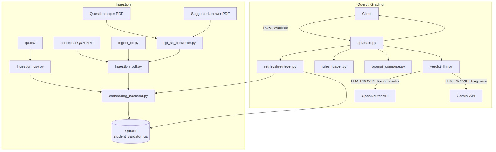
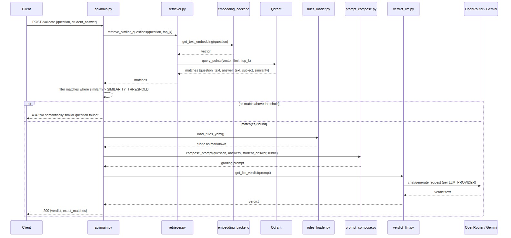

# RAG Student-Answer Validator

Grades a student's written answer against a Q&A bank and a legal-assessment rubric.
A question is embedded and matched against a Qdrant collection of reference
question/answer pairs; if a good match is found, the question itself, the
reference answer(s), the student's answer, and the rubric (`business_rules.yaml`)
are sent to an LLM (OpenRouter or Gemini, configurable), which returns a
graded verdict.

## Architecture



<sub>Source: [docs/diagrams/architecture.mmd](docs/diagrams/architecture.mmd) — edit and re-render with mermaid-cli if the design changes.</sub>

| Module | Role |
|---|---|
| `ingestion/` | Load Q&A pairs (CSV or PDF) into Qdrant |
| `retrieval/retriever.py` | Embed a question, search Qdrant for top-k matches |
| `llm_verdict/` | Load rubric, compose the grading prompt, call the LLM |
| `api/` | FastAPI `/validate` endpoint |
| `pdf_render/render_pdf.py` | Render `qa_content.md` → styled PDF + `qa.csv` (output, not ingestion) |
| `embedding_backend.py` | Switches embedding implementation via `EMBED_BACKEND` |
| `llm_verdict/verdict_llm.py` | Switches LLM provider via `LLM_PROVIDER` |

## Request flow

What happens on a `POST /validate` call:



<sub>Source: [docs/diagrams/request_flow.mmd](docs/diagrams/request_flow.mmd) — edit and re-render with mermaid-cli if the flow changes.</sub>

## Setup

**1. Start Qdrant** (no local `qdrant` binary is bundled — use Docker):
```bash
docker run -d -p 6333:6333 qdrant/qdrant
```

**2. Install dependencies:**
```bash
pip install -r requirements.txt
```

**3. Create a `.env`** in `rag_mm/`:
```bash
QDRANT_HOST=localhost
QDRANT_PORT=6333
EMBED_MODEL=all-MiniLM-L6-v2
EMBED_BACKEND=sentence_transformers   # or llama_index_hf
COLLECTION_NAME=student_validator_qa
TOP_K=2
SIMILARITY_THRESHOLD=0.8

# LLM provider -- pick one, see "Switching LLM provider" below
LLM_PROVIDER=openrouter
LLM_PROVIDER_BASE_URL=https://openrouter.ai/api/v1
LLM_MODEL=openai/gpt-3.5-turbo-1106
OPENROUTER_API_KEY=sk-...

# Weakness-evaluation layer -- see "Weakness evaluation & retry" below
EVAL_THRESHOLD=0.90
EVAL_MAX_ATTEMPTS=3
```

**4. Ingest your Q&A data** — see below.

**5. Start the API:**
```bash
python -m uvicorn api.main:app --reload
```

**6. Query it:**
```bash
curl -X POST localhost:8000/validate \
  -H "Content-Type: application/json" \
  -d '{"question": "What is GST?", "student_answer": "GST is an indirect tax..."}'
```
Returns 404 if no reference question scores above `SIMILARITY_THRESHOLD`.

## Weakness evaluation & retry

After a verdict is generated, a second ("checker") LLM call scores the verdict's Weaknesses
section for whether each claim is (a) grounded -- factually true of the student's answer, not
a hallucinated omission -- and (b) applicable -- something this specific question actually calls
for, not a rubric criterion forced onto a question it doesn't fit. The score is a float in
`[0.0, 1.0]`.

If the score is below `EVAL_THRESHOLD` (default `0.90`), the verdict is regenerated with the
checker's critique folded into the prompt, up to `EVAL_MAX_ATTEMPTS` total cycles (default `3`).
Whichever attempt scored highest is returned either way -- `meets_quality_threshold: false` in
the response means none of the attempts crossed the threshold, not that the request failed.

The checker's own LLM provider/model can be set independently of the verdict LLM's:
```bash
EVAL_LLM_PROVIDER=gemini            # optional; falls back to LLM_PROVIDER if unset
EVAL_LLM_MODEL=gemini-2.5-pro       # optional; falls back to LLM_MODEL if unset
EVAL_OPENROUTER_API_KEY=...         # optional; falls back to OPENROUTER_API_KEY if unset
EVAL_GEMINI_API_KEY=...             # optional; falls back to GEMINI_API_KEY if unset
```

`ValidateResponse` includes `meets_quality_threshold`, `quality_score`, and `attempts` (one entry
per generate+evaluate cycle actually run). Each attempt carries its verdict text, parsed
strengths/weaknesses/grade, the checker's score and critique, and token accounting for both LLM
calls: `provider_usage` (exact `prompt_tokens`/`completion_tokens`/`total_tokens` as reported by
the provider) and `local_prompt_breakdown` (an approximate per-section token count -- question,
rubric, student answer, textbook answer, instructions -- computed locally via `tiktoken`, since no
single tokenizer exactly matches every model reachable through OpenRouter).

## Ingesting files

Every ingestion path writes the same record shape into Qdrant:
`{question_text, answer_text, subject}`, embedding only `question_text`.

### CSV

`qa.csv` with columns `question_text`, `answer_text`, `subject`:

```bash
python -m ingestion.ingestion_csv
```

### PDF — CLI

`ingest_cli.py` covers both PDF formats without writing any code:

```bash
# One or more canonical Question/Answer/Subject PDFs (see qa_content.pdf)
python ingest_cli.py qa_content.pdf more_qa.pdf

# A question-paper + suggested-answer pair
python ingest_cli.py --pair "VOID AGREEMENTS(FREECONSENT)-QP.pdf" "VOID AGREEMENTS(FREECONSENT)-SA.pdf"

# Mix both, and multiple pairs, in one run
python ingest_cli.py qa_content.pdf \
  --pair "Chapter1-QP.pdf" "Chapter1-SA.pdf" \
  --pair "Chapter2-QP.pdf" "Chapter2-SA.pdf"
```

Run `python ingest_cli.py -h` for the full option list.

### PDF — canonical Q&A format (from Python)

For PDFs shaped like `qa_content.pdf` (numbered entries, each with an explicit
`Question` / `Answer` / `Subject:` block — same layout `render_pdf.py`
produces from markdown):

```python
from ingestion.ingestion_pdf import main

main(pdf_paths=["qa_content.pdf", "more_qa.pdf"])
```

### PDF — separate question paper + suggested answer (from Python)

For exam-style PDFs where questions and answers live in two separate files
(question paper with nested `Question N` → `a)/b)/c)` → `i)/ii)` sub-parts,
answer paper with matching `Question No. N(a)(i) [XM]`-style headers):

```python
from ingestion.ingestion_pdf import main

main(qp_sa_pairs=[
    ("VOID AGREEMENTS(FREECONSENT)-QP.pdf", "VOID AGREEMENTS(FREECONSENT)-SA.pdf"),
])
```

Each sub-part becomes its own Q&A record (e.g. `1a`, `2a-i`, `2a-ii`, `2b`...),
matched between the two files by their `[XM]` mark sequence rather than by
lettering — the lettering can drift between the question paper and the answer
key, but the mark sequence is a reliable positional anchor. `subject` is taken
from the paper's `Chapter:` header.

**If the two files don't have the same number of marked sub-parts**, the pair
is skipped and a `NEEDS REVIEW` warning is printed instead of guessing at a
pairing — fix the mismatch (or the PDFs) and re-run.

**If a sub-part's mark values disagree** between the QP and the SA (a source
typo, not a structural problem), the pair is still ingested but a `VERIFY`
warning is printed so you can double check it.

You can mix both PDF formats and CSV in one ingestion run:

```python
from ingestion.ingestion_pdf import main

main(
    pdf_paths=["qa_content.pdf"],
    qp_sa_pairs=[("chapter1-QP.pdf", "chapter1-SA.pdf")],
)
```

### Choosing a source format

- Already have one clean file per topic with explicit Question/Answer/Subject
  markers → canonical PDF (or CSV).
- Have real exam papers split into a question paper and a separate suggested-
  answer document → QP+SA converter.

## Switching embedding backends

`EMBED_BACKEND` env var controls `embedding_backend.get_embedder()`:
- `sentence_transformers` (default) — uses `sentence-transformers` directly.
- `llama_index_hf` — uses llama-index's `HuggingFaceEmbedding` wrapper.

Both expose the same `get_text_embedding(text)` interface, so nothing else
needs to change when you switch.

## Switching LLM provider / model

`LLM_PROVIDER` env var controls `llm_verdict.verdict_llm.get_llm_verdict()`.
Everything else (retrieval, prompt composition, the `/validate` contract) is
identical regardless of provider — only the `.env` changes.

**OpenRouter** (default):
```bash
LLM_PROVIDER=openrouter
LLM_PROVIDER_BASE_URL=https://openrouter.ai/api/v1
LLM_MODEL=openai/gpt-3.5-turbo-1106
OPENROUTER_API_KEY=sk-...
```

**Gemini** — e.g. Gemini 2.5 Pro:
```bash
LLM_PROVIDER=gemini
LLM_MODEL=gemini-2.5-pro
GEMINI_API_KEY=AIza...
```
Get a key from [Google AI Studio](https://aistudio.google.com/apikey).

To add another provider later, add a `_get_<provider>_verdict(prompt)`
function in `llm_verdict/verdict_llm.py` and register it in the `_PROVIDERS`
dict — same pattern as `embedding_backend.py`.

## Tests

```bash
pytest
```
Requires Qdrant running; `tests/conftest.py` re-ingests `qa.csv` before the
suite runs.
